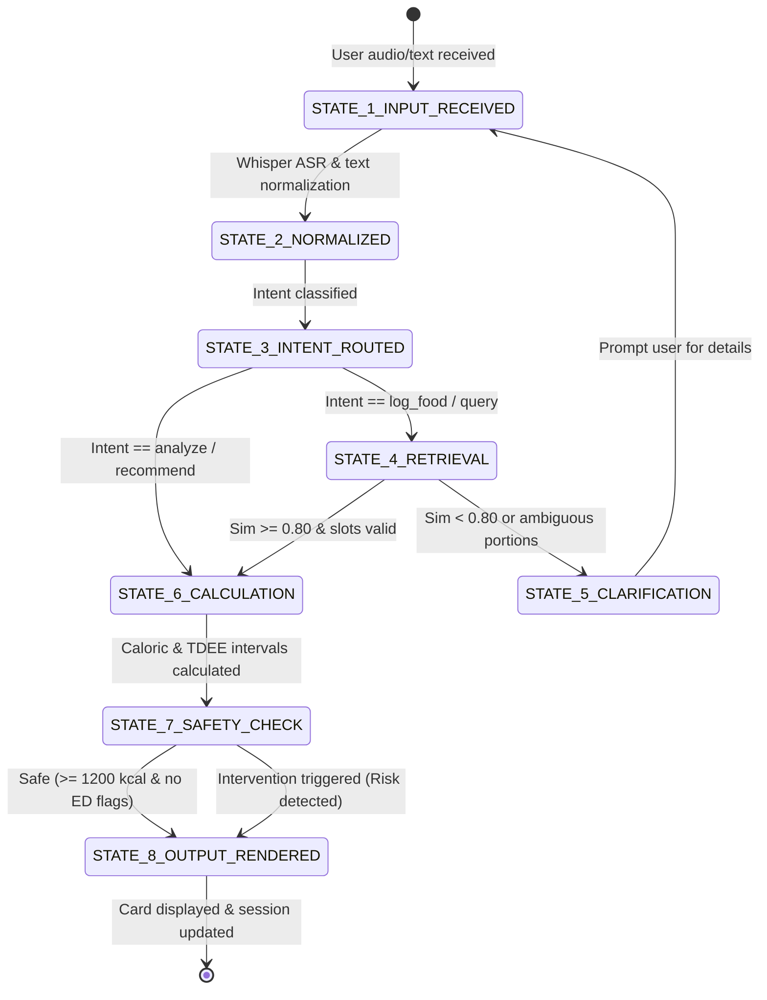

# OpenSpec Design Workflow: DietSense Agent System Architecture

## 1. Executive Summary & Design Paradigm
This document establishes the technical workflow specification for **DietSense**, translating conceptual system designs into verifiable, event-driven state transitions under the OpenSpec standard.

The core architectural paradigm is:
> **"LLM acts as the conversational orchestrator; deterministic services perform numerical calculations; official clinical guidelines enforce safety."**

---

## 2. Event-Driven Workflow State Machine

DietSense operates as a finite state machine (FSM) transitioning across 8 distinct states:



### State Definitions & Transitions:
1. `STATE_1_INPUT_RECEIVED`: Accepts raw natural language input (microphone audio or chat text).
2. `STATE_2_NORMALIZED`: Converts speech to text via Whisper-large-v3, rectifies Traditional Chinese variants, and extracts candidate food phrases.
3. `STATE_3_INTENT_ROUTED`: Dispatches control to `log_food`, `query_nutrition`, `analyze_trends`, or `recommend_diet`.
4. `STATE_4_RETRIEVAL`: Dispatches parallel queries across ChromaDB (Taiwan snack vectors), Taiwan Food Composition DB, and USDA API.
5. `STATE_5_CLARIFICATION`: Initiates a targeted single-turn clarification question when ambiguity exceeds tolerance ($S < 0.80$).
6. `STATE_6_CALCULATION`: Executes deterministic mathematical functions (Mifflin-St Jeor equation, portion weight integration, error propagation).
7. `STATE_7_SAFETY_CHECK`: Evaluates total caloric targets against clinical safety rules ($<1,200\text{ kcal/day}$ floor, eating disorder heuristics).
8. `STATE_8_OUTPUT_RENDERED`: Synthesizes UI card, confidence intervals, interactive bar charts, and updates database session logs.

---

## 3. Whitelisted Function Calling Tool Specifications

The LLM is strictly isolated from calculations. The LLM interacts with external services exclusively through the following four JSON-Schema defined tools:

### Tool 1: `search_taiwan_food_database`
* **Description**: Queries Taiwanese cuisine vector database and official nutritional databases.
* **Parameters**:
  ```json
  {
    "type": "object",
    "properties": {
      "query_text": {
        "type": "string",
        "description": "Standardized Chinese name of the food item, e.g., '牛肉麵'"
      },
      "category": {
        "type": "string",
        "enum": ["street_snack", "mixed_dish", "beverage", "standard_ingredient"],
        "description": "Category hint for filtered retrieval"
      },
      "top_k": {
        "type": "integer",
        "default": 3
      }
    },
    "required": ["query_text"]
  }
  ```

### Tool 2: `compute_deterministic_energy`
* **Description**: Computes exact caloric and macronutrient values from retrieved database entries and portion estimates.
* **Parameters**:
  ```json
  {
    "type": "object",
    "properties": {
      "item_id": { "type": "string", "description": "Database key" },
      "portion_weight_g": { "type": "number", "description": "Estimated weight in grams" },
      "weight_uncertainty_ratio": { "type": "number", "default": 0.15 }
    },
    "required": ["item_id", "portion_weight_g"]
  }
  ```

### Tool 3: `calculate_mifflin_tdee`
* **Description**: Calculates BMR and TDEE based on physical attributes.
* **Parameters**:
  ```json
  {
    "type": "object",
    "properties": {
      "weight_kg": { "type": "number" },
      "height_cm": { "type": "number" },
      "age_years": { "type": "integer" },
      "biological_sex": { "type": "string", "enum": ["male", "female"] },
      "activity_level": {
        "type": "string",
        "enum": ["sedentary", "light", "moderate", "active", "extreme"]
      }
    },
    "required": ["weight_kg", "height_cm", "age_years", "biological_sex", "activity_level"]
  }
  ```

### Tool 4: `evaluate_safety_boundary`
* **Description**: Evaluates planned daily caloric totals and user messages for clinical risk triggers.
* **Parameters**:
  ```json
  {
    "type": "object",
    "properties": {
      "total_planned_kcal": { "type": "number" },
      "user_message": { "type": "string" },
      "user_gender": { "type": "string", "enum": ["male", "female"] }
    },
    "required": ["total_planned_kcal", "user_message"]
  }
  ```

---

## 4. Pseudocode: Master Orchestration Algorithm (Algorithm 1)

```python
01: Algorithm 1: DietSense_Master_Workflow
02: Input : UserInput Q, UserProfile P, DailySessionState S
03: Output: MultimodalCard R, UpdatedSessionState S'
04: ---------------------------------------------------------------------------------
05: 01: text ← Whisper_Transcribe_And_Clean(Q)
06: 02: intent ← Route_Intent(text)
07: 03:
08: 04: IF intent == "log_food" THEN
09: 05:     entities ← Extract_Food_Entities(text)          // e.g. [{name: "牛肉麵", portion: "一碗", soup: "半碗"}]
10: 06:     verified_meal ← []
11: 07:     FOR EACH item IN entities DO
12: 08:         candidates, sim_score ← Call_Tool("search_taiwan_food_database", {query_text: item.name})
13: 09:         
14: 10:         // Clarification loop when uncertainty is high
15: 11:         IF sim_score < 0.80 OR item.is_ambiguous THEN
16: 12:             clarify_prompt ← Generate_Targeted_Question(item, candidates)
17: 13:             clarified_answer ← Prompt_User_Clarification(clarify_prompt)
18: 14:             item ← Refine_Entity_Attributes(item, clarified_answer)
19: 15:             candidates, sim_score ← Call_Tool("search_taiwan_food_database", {query_text: item.name})
20: 16:         END IF
21: 17:         
22: 18:         grams, weight_err ← Standardize_Household_Portion(item.portion)
23: 19:         nutrients ← Call_Tool("compute_deterministic_energy", {item_id: candidates[0].id, portion_weight_g: grams})
24: 20:         verified_meal.append(nutrients)
25: 21:     END FOR
26: 22:     S.records.append(verified_meal)
27: 23: END IF
28: 24:
29: 25: // Energy balance computation
30: 26: daily_totals ← Sum_Nutrients(S.records)
31: 27: tdee_profile ← Call_Tool("calculate_mifflin_tdee", P.attributes)
32: 28: balance_delta ← daily_totals.kcal - tdee_profile.tdee
33: 29:
34: 30: // Clinical safety gate
35: 31: safety_result ← Call_Tool("evaluate_safety_boundary", {
36: 32:     total_planned_kcal: daily_totals.kcal,
37: 33:     user_message: text,
38: 34:     user_gender: P.gender
39: 35: })
40: 36:
41: 37: IF safety_result.is_violated THEN
42: 38:     R ← Render_Safety_Alert_Card(safety_result.warning_text, safety_result.hotlines)
43: 39: ELSE
44: 40:     advice ← Synthesize_Guidance(daily_totals, tdee_profile, P.goal)
45: 41:     R ← Render_Rich_Nutrition_Card(verified_meal, daily_totals, balance_delta, advice)
46: 42: END IF
47: 43:
48: 44: S' ← Update_Persistent_State(S)
49: 45: RETURN R, S'
```

---

## 5. End-to-End Verification Flow

1. **Input**: "我剛吃了一碗加蛋牛肉麵，湯喝了一半。"
2. **Entity Extraction**:
   - Item 1: `牛肉麵` | Quantity: `一碗` | Broth: `半碗`
   - Item 2: `蛋` | Quantity: `一顆`
3. **Clarification Trigger**: Item 1 missing size (`小碗`/`大碗`) and egg type (`滷蛋`/`水煮蛋`), $S = 0.74 < 0.80$.
4. **Agent Action**: Asks user to specify bowl size and egg preparation.
5. **Clarification Answer**: "小碗，加滷蛋。"
6. **Execution**:
   - Small beef noodle soup (160g noodles + 60g beef + 250ml broth) = $570 \pm 45\text{ kcal}$.
   - Marinated egg (50g) = $75 \pm 5\text{ kcal}$.
   - Total Meal Caloric Interval: **$645 \pm 50\text{ kcal}$** ($595\sim 695\text{ kcal}$).
7. **Safety Verification**: User logged daily total = 1,480 kcal ($> 1,200\text{ kcal}$ safe threshold). No ED keywords.
8. **Render**: Multimodal UI card displaying interval, macronutrient breakdown (P: 36g, C: 68g, F: 24g), and source provenance citations.

