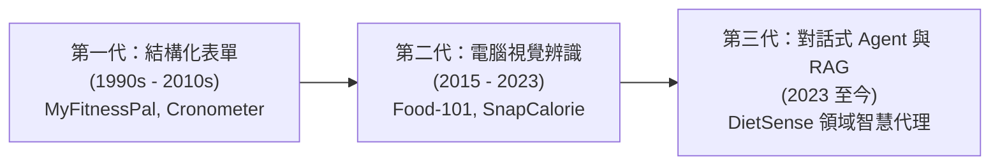

# DietSense 專案重構：Introduction 緒論

> 本章節嚴格依據 2020 A-Z SOP 的 **G～L 架構** 與《期末專題提案作業規範》重構，全面回答核心問題：**"Why is this project worth doing?"**

---

## G. General 現況（市場爆發、流行病學趨勢與生活型態醫學）

全球公共衛生正面臨代謝異常相關慢性疾病的空前考驗。世界衛生組織（WHO, 2024/2025）流行病學報告指出，全球已有超過 26 億成人處於超重狀態，其中肥胖人口高達 9.4 億；飲食不良與能量失衡已超越吸菸，成為全球非傳染性慢性病（心血管疾病、第 2 型糖尿病、高血壓及脂肪肝）的主要風險因子，佔全球死因之 74%（WHO, 2025）。

在臺灣，衛生福利部國民健康署 2024–2025 年度國民營養健康調查顯示，18 歲以上成年人過重及肥胖盛行率達到 **47.9%**，相當於每兩位成年人中即有一人面臨體重過重風險。健保署統計數據進一步表明，因肥胖引發之代謝症候群、心血管事件與洗腎等併發症，每年造成的直接與間接醫療支出超過新台幣 **500 億元**。

在此嚴峻背景下，**「生活型態醫學（Lifestyle Medicine）」與日常「飲食自我監測（Dietary Self-Monitoring）」**被國際臨床醫學證實為體重管理最有效、最具成本效益的干預手段。最新臨床隨機對照試驗顯示（Teixeira et al., 2025），能長期保持每週至少 5 天飲食記錄的受試者，達成 5% 以上顯著減重目標的成功率是未記錄者的 **2.1 倍**。受到此一醫學實證推動，全球數位健康與智慧飲食管理應用市場急速成長，市場調研機構 Grand View Research（2025）評估全球飲食追蹤與數位健康市場規模已達 **68 億美元**，預計 2025–2030 年間將以 17.4% 的年複合成長率（CAGR）持續擴張，顯示公眾與醫療機構對數位化營養輔助系統存在巨大的真實需求。

---

## H. However 挑戰深入（四項核心認知障礙與行為瓶頸）

儘管飲食自我監測在臨床上極具價值，但現有工具的實際使用率與長期留存率卻呈現慘澹對比。著名的 SMARTER 臨床行為試驗（Burke et al.）及後續數位追蹤研究均揭示：**高達 85% 的使用者在開始記錄後的 30 天內即停止使用**，留存率曲線呈現斷崖式非線性下滑，且基線 BMI 較高（即最需要介入）的使用者，其遵從率反而最低。

本研究深入分析使用者行為與心理負擔，將現有飲食追蹤工具的根本瓶頸歸納為**四大核心障礙**：

1. **手動搜尋與分解的高認知負擔（Search & Decomposition Friction）**：
   現行主流 App（如 MyFitnessPal、FatSecret、Cronometer）採取傳統表單式設計。使用者進食後，必須在數十萬筆食物清單中逐一搜尋食材名稱、選擇品牌、估算物理克數。當面對混合烹調菜餚時，系統強迫使用者在腦中將其逆向拆解為生鮮原料（例如將「一碗餛飩湯」拆解為絞肉、麵皮、高湯、香油、芹菜），這在快速用餐與外食環境中造成了嚴重的心理抗拒與認知過載。
2. **份量估算的主觀模糊與系統性偏差（Portion Ambiguity & Misreporting）**：
   流行病學與營養評估文獻（Poslusna et al., 2024; Subar et al.）反覆證實，一般人在自我回報飲食攝取量時，存在高達 **18% 至 54% 的系統性低估誤差**。人們普遍對容器容量（「碗」、「杯」、「盤」）缺乏精確概念，且極易忽略烹調過程中的「隱藏油脂」、「糖分佐料」與「濃郁湯底」，導致最終記錄之卡路里數值失真，喪失追蹤與指導價值。
3. **臺灣本土飲食文化的嚴重覆蓋缺口（Cultural Food Gap）**：
   主流商業軟體多發源於歐美，其營養成分庫（如 USDA 或歐美品牌包裝食品）對東亞，尤其是臺灣極具特色的「外食小吃、夜市餐飲、複合自助餐、手搖茶飲」覆蓋率極度匱乏。當臺灣使用者搜尋「蚵仔煎、大腸包小腸、排骨便當、半糖微冰四季春」時，系統往往查無此項，或只能匹配到毫無關聯的西方近似食物，迫使使用者放棄記錄。
4. **通用大型語言模型（LLM）的黑盒幻覺與安全隱憂（LLM Hallucination & Safety Risks）**：
   隨著生成式 AI 普及，許多使用者嘗試直接向 ChatGPT 等通用聊天機器人詢問「我今天這餐有多少熱量？」。然而最新實證評估研究顯示（Frontiers in Nutrition, 2025），未經資料錨定與專業微調的通用 LLM 在估算食物熱量時，其**平均絕對百分比誤差（MAPE）高達 35.8%**，且對重量估算的 MAPE 亦達 36.3%，經常隨機捏造數值（Hallucination）。更危險的是，通用 LLM 缺乏醫學安全邊界，可能對追求極端減重的個體給出每日低於 800 kcal 的病理性建議，潛藏誘發厭食症或營養不良的重大公共安全風險。

---

## I. In literature 文獻解法演進（從手動記錄到智慧代理的三代轉移）

回顧資訊科技與人機互動（HCI）在飲食監測領域的演進歷程，文獻與產業發展經歷了三代主要典範：

1. **第一代：結構化資料庫與手動檢索系統（1990s–2010s）**：
   以 MyFitnessPal、Cronometer 為代表。其架構本質上是關聯式資料庫的前端 GUI。優點是資料結構透明、支援條碼掃描；致命缺點是記錄摩擦力巨大，將數據標準化的負擔完全轉嫁給終端使用者，導致長期留存率低於 15%。
2. **第二代：基於電腦視覺的相機拍照識別系統（2015–2023）**：
   隨著卷積神經網路（CNN）與 Vision Transformer（ViT）成熟，如 Food-101、SnapCalorie 等研究嘗試透過智慧型手機鏡頭直接辨識餐盤內容。然而實務驗證發現，2D 影像無法穿透視角盲區，無法偵測食物內部隱藏的油脂與糖分，更難以估算羹湯、火鍋等高水分菜餚的實際固形物重量，其整體熱量估算誤差仍達 30% 以上，且在公共用餐場合拍照記錄易引起社交尷尬。
3. **第三代：自然語言對話、RAG 資料錨定與智慧代理架構（2023 至今，新興前沿）**：
   利用大型語言模型（LLM）強大的上下文理解與常識推理能力，使用者僅需以自然的日常口語（文字或語音）描述餐點，由 Agent 負責實體辨識、情境推論與追問。然而，現有研究多停留在 Prompt Engineering 或單純呼叫單一向量資料庫，尚未建立起**「意圖分流、在地資料檢索、確定性代謝計算、不確定性傳遞與醫學安全守門」**一體化的完整領域架構。

---

## J. Judgement 方法優缺點評析與 SWOT 分析

為釐清既有技術方案與本研究提案之差異，本研究將現存主流方法進行系統化對比與 SWOT 評判：

| 方案維度 | 第一代：手動搜尋 App | 第二代：拍照視覺 AI | 通用對話 LLM（無工具） | **DietSense（本提案 Domain AI Agent）** |
| :--- | :--- | :--- | :--- | :--- |
| **輸入方式** | 多層階層式表單搜尋 | 手機相機拍攝 2D 照片 | 純文字提示詞問答 | **自然語言（語音／文字）對話式互動** |
| **操作負擔** | 極高（單餐平均需耗時 90~150 秒） | 低（拍照僅需 5 秒） | 極低（輸入一段文字約 15 秒） | **極低（語音輸入約 10~15 秒完成）** |
| **在地飲食覆蓋** | 依賴使用者 UGC，品質良莠不齊 | 受限於西方資料庫訓練集 | 能理解台式菜名但營養數值失真 | **自建臺灣外食小吃向量庫 + 官方成分庫** |
| **隱藏成分推理** | 需手動手動調整油鹽選項 | 完全無法穿透 2D 外觀 | 具有推理概念但數值純靠猜測 | **透過 Clarification Loop 主動追問釐清** |
| **數值可信度** | 高（官方項目）至低（網友輸入） | 中等（體積估算誤差大） | 極低（幻覺嚴重，MAPE $\approx 35.8\%$） | **極高（白名單資料庫確定性計算，拒絕幻覺）** |
| **結果呈現型態** | 偽精確之單一數值 | 預測單一數值 | 隨機單一數值 | **動態信賴區間（例如 $650 \pm 80\text{ kcal}$）** |
| **安全守門機制** | 無（僅有靜態警告） | 無 | 弱（可能附和偏激節食行為） | **強（內建 $<1200\text{ kcal}$ 熔斷與失調攔截）** |

**核心判斷（Judgement）**：
純科技無法解決複雜的健康行為問題。純手動工具太痛苦，純視覺工具不精確，純生成模型不可靠。唯一可行的工程路徑是**「將 LLM 限制為對話協調者與推理引擎，將計算與資料權限交還給經過檢驗的領域工具與確定性資料庫」**。

---

## K. Keypoint 設計精神、核心亮點與預期貢獻（Contribution Summary）

本專案提出 **DietSense** 系統，其核心設計精神在於實現從「被動式熱量追蹤（Passive Calorie Tracking）」邁向「主動式、情境感知的個人化體重管理（Proactive, Context-Aware Weight Management）」。

本專案確認之**四大核心亮點**：
1. **自然語言輸入（Natural Language Input）**：支援繁體中文日常口語與語音輸入，透過 Whisper 與實體辨識，免除階層式表單操作。
2. **主動式智慧互動（Proactive Agentic Interaction）**：內建動態 Clarification Loop，當檢索信心低於 80% 時主動追問份量與烹調細節，告別死板問答。
3. **情境感知（Context Awareness）**：整合個人身體素質、歷史飲食趨勢、生理目標與用餐時段，動態給予適切指引。
4. **大數據驅動智慧（Big Data–Driven Intelligence）**：整合臺灣衛福部食品資料庫、USDA FoodData Central 與在地外食向量庫，提供具可解釋性、可追溯性的數據支撐。

**主要研究與工程貢獻（Contribution Summary）**：
* **架構創新**：提出一套解耦「自然語言意圖理解」與「數值計算」的八模組 Domain AI Agent 架構，為醫療健康領域 LLM 落地提供可稽核的安全典範。
* **在地資源貢獻**：規劃建置 500 筆高質量臺灣特色外食（夜市小吃、便當、手搖茶飲）標註基準測試集（Benchmark），填補現有學術研究之在地資料庫空白。
* **人機互動突破**：透過主動追問與信賴區間呈現，預期將記錄耗時縮短 60%、$\pm 20\%$ 估算達標率提升至 85% 以上，顯著改善長期飲食監測之使用者遵從性。

---

## L. List Organization 文章結構交代

本提案文件後續章節組織如下：
* **第 2 節（Related Work & Deep Research）**：深入梳理 AI 代理技術與營養代謝領域之最新文獻，建立 5 篇文獻摘要表（Article Summary Table），並完整剖析 5 大核心思維、3 大專業爭論與 10 個深度問題。
* **第 3 節（Proposed Scheme & Design Workflow）**：依據 PA～PM 規範詳細展開 DietSense 八大模組架構、系統資料流、核心演算法 Pseudocode（Algorithm 1）與不確定性傳遞模型。
* **第 4 節（Experiments & Evaluation Plan）**：說明 500 筆在地外食資料集規劃、與 MyFitnessPal 之 Baseline 對比實驗設計，以及 20 名受試者為期 7 天之使用者研究（User Study）評估指標。
* **第 5 節（Conclusion & Future Work）**：總結本專案之預期產出、工程限制與未來多模態及連續生理監測之擴展規劃。

