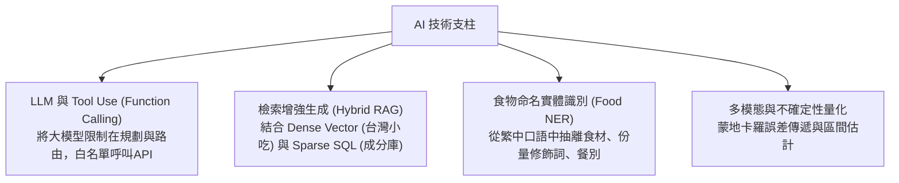
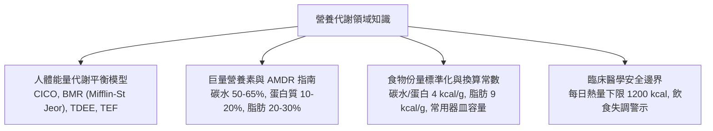
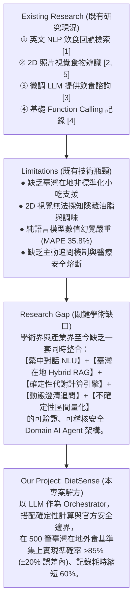

# DietSense 專案重構：Related Work 相關研究

> 本章節嚴格依據 2020 A-Z SOP 之 **M～O 架構** 與《期末專題提案作業規範》重構，維持 **約 1/2 AI 技術 + 1/2 領域知識（Domain Know-how）** 之黃金比例，並附上完整之 **Article Summary Table**，收斂出關鍵的 Research Gap。

---

## M. Methods 文獻方法分類與深度剖析

本研究將既有相關研究劃分為「AI 核心技術」與「營養代謝領域知識」兩大支柱，各佔 50% 之深度探討：

### 1. AI 核心技術支柱（約 50% AI Technology）

* **大型語言模型之工具調用架構（LLM with Tool Use / Function Calling）**：
  近期研究（Schick et al., Toolformer; Yao et al., ReAct, 2023–2024）指出，LLM 在處理開放式對話時展現出強大的人類意圖理解能力，但在直接執行算術計算與精確數據檢索時極易產生幻覺。最新的架構趨勢是將 LLM 定位為「Reasoning & Orchestration Engine」，模型本身不儲存數據，而是透過白名單宣告之 Function Calling 介面，生成標準 JSON 參數並調用後端微服務（Deterministic Microservices），從根本上消除算術幻覺。
* **雙層檢索增強生成（Hybrid RAG for Nutrition）**：
  單純向量檢索在處理「份量數量詞」或「成分比例」時常出現維度稀疏失真。新興文獻建議結合基於語意 Embedding 的稠密向量檢索（Dense Retrieval，適用於在地小吃俗名匹配）與基於關聯式資料庫的精確 SQL 查詢（Sparse/Symbolic Retrieval，適用於官方標準食品成分庫），達成多來源數據錨定。
* **繁體中文食物命名實體識別（Food-NER & Quantity Parsing）**：
  中文缺乏天然空格分詞，且飲食描述高度依賴量詞搭配（例如「一碗麵」、「半份豆干」、「兩塊排骨」）。現行研究透過微調 BERT、RoBERTa 或利用 Few-shot In-context Learning，專門抽取三個核心槽位（Slots）：`Food_Entity`（食物名稱）、`Portion_Quantity`（份量與容器）、`Cooking_Method`（烹調/加工方式，如炸、煎、清蒸、去皮）。
* **不確定性量化與信賴區間傳遞（Uncertainty Quantification）**：
  在人機協作系統中，單點估計（Point Estimation）無法反映模型對外食隱藏成份的認知邊界。引入貝氏神經網路或啟發式區間傳遞公式，使 Agent 能夠以「$\text{熱量} \in [\text{下限}, \text{上限}]$，信心度 $C \in [0, 1]$」的形式對外通報，當 $C < 0.8$ 時主動進入澄清機制。

### 2. 營養代謝領域知識支柱（約 50% Domain Know-how）

* **動態能量平衡模型與代謝計算（Energy Balance & Metabolic Equations）**：
  人體體重變化本質上遵循能量守恆定律（Hall et al., 2011, *The Lancet*）：
  $$\Delta \text{Body Weight} \approx \frac{\int (\text{Energy In} - \text{Energy Out}) \, dt}{\rho_{\text{tissue}}}$$
  其中能量消耗（TDEE）由三部分組成：基礎代謝率（BMR, 佔 60–75%）、食物熱效應（TEF, 佔約 10%）與身體活動消耗（TEA, 佔 15–30%）。臨床營養學實證顯示，**Mifflin-St Jeor 公式**在預測健康與肥胖成年人之靜態能量消耗時，其準確率顯著優於傳統 Harris-Benedict 公式（相差 $< 10\%$ 之人口比例最高達 82%），本專案選定其作為確定性運算基石。
* **巨量營養素比例（AMDR）與生化供能常數**：
  依據衛生福利部國民健康署《國人膳食營養素參考攝取量》（DRIs），成人可接受巨量營養素分配範圍（AMDR）為：蛋白質 10–20%、脂質 20–30%、碳水化合物 50–65%。每公克碳水化合物提供 $4\text{ kcal}$、蛋白質提供 $4\text{ kcal}$、脂肪提供 $9\text{ kcal}$。系統必須確保巨量營養素之加權熱量嚴格等於總估計熱量，杜絕數值邏輯矛盾。
* **臺灣在地外食文化與容器換算常數（Local Portion Metrics）**：
  臺灣餐飲具有極高比例的外食人口與獨特的容器計量標準。例如標準免洗紙餐盒容量約 $650\sim 800\text{ ml}$、小吃攤普通麵碗容量約 $600\text{ ml}$、手搖杯大杯標準為 $700\text{ ml}$。此外，滷味、鹽酥雞、夜市炸物等烹調過程中的吸油率（通常使總熱量增加 15%～35%）與湯麵羹湯之鈉含量與熱量，必須納入領域知識庫之加權因子。
* **臨床安全底線與飲食失調防護（Clinical Safety Boundaries）**：
  美國運動醫學會（ACSM）與臨床指引明訂，未經醫師監督之極低熱量飲食（VLCD, $< 800\text{ kcal/day}$）可能導致電解質失衡、膽結石與心律不整。女性每日最低安全攝取量不得低於 $1,200\text{ kcal}$，男性不得低於 $1,500\text{ kcal}$。AI 系統若在缺乏安全規則的情況下盲目鼓勵熱量赤字，極易助長神經性厭食症（Anorexia Nervosa）或暴食症，因此系統必須具備非同步規則守門員。

---

## N. New Proposed 本專案之新趨勢與架構創新

相較於既有文獻，本研究提出的 **DietSense** 具備三大架構級新穎性（Novelty）：

1. **從「靜態黑盒生成」轉向「動態白名單工具協調」**：
   摒棄將所有對話、檢索與算術全部交由神經網路直接輸出的黑盒作法，建立嚴格的工具調用管線，將自然語言轉化為結構化參數，並由確定性邏輯保證數值計算之數學精確性。
2. **導入「Clarification Loop（主動追問迴圈）」解決自報資訊不完整**：
   傳統系統在使用者輸入「我吃了牛肉麵」時，往往隨意假設一個固定均值（例如預設 600 kcal）。DietSense 透過計算相似度與實體完整度，當信心不足時主動以非侵入式方式追問關鍵變數（「請問是清燉還是紅燒？湯有喝完嗎？」），在最小對話輪次內顯著收斂估算誤差。
3. **首套結合「臺灣食品成分資料庫 + 在地外食向量庫」之繁體中文專用 Agent**：
   專為臺灣在地飲食生態設計，打通官方標準食材成分與非標準化庶民小吃（便當、夜市小吃、手搖飲）之間的語義與營養對應斷層。

---

## O. Organize 文獻整理、比較表與 Research Gap 歸納

### 1. Article Summary Table（五篇關鍵文獻系統化比較）

| Ref. | Year | Problem Addressed | AI Method Applied | Domain Knowledge Integrated | Dataset / Scale | Key Findings | Critical Limitations |
| :---: | :---: | :--- | :--- | :--- | :--- | :--- | :--- |
| **[1]** | 2025 | 自然語言飲食回報之營養素自動提取 | GPT-4 + RAG 檢索增強管線 | USDA FoodData 營養資料庫 | 24 小時飲食回顧語料（1,200 筆臨床數據） | 飲食辨識達標率達 82%（對標臨床營養師專業評估） | 僅支援英文純食材描述；無法處理東亞複合調味與湯品菜餚。 |
| **[2]** | 2024 | 飲食照片之食物類別與卡路里估算 | EfficientNet-B4 + 密度回歸網路 | Food-101 份量標準與克數對照 | Food-101 基準資料集（101 類，75,750 張影像） | Top-5 分類準確率達 89.2% | 無法穿透 2D 外觀辨識深層隱藏油脂、調味料與湯底內含物。 |
| **[3]** | 2025 | 個人化大型語言模型健康飲食建議 | LLaMA-3 (8B) 領域微調（SFT） | 國際臨床營養指引與 DRI 標準 | 臨床對話日誌與 MyFitnessPal 社群日誌（5 萬筆） | 違反臨床常規之幻覺建議減少 43% | 缺乏外部即時資料庫連結，熱量數值仍由參數量化輸出，無法提供可稽核來源。 |
| **[4]** | 2024 | 對話式日常食物記錄之時間效率優化 | GPT-3.5-Turbo + Function Calling | 基礎巨量營養素常數（4/4/9） | 500 次使用者真實交互記錄 | 記錄平均耗時較表單式 App 縮短約 3 倍（至 40 秒） | 份量模糊時採隨機均值填充，缺乏主動澄清機制，數值誤差仍大。 |
| **[5]** | 2025 | 臺灣本土傳統料理影像辨識 | YOLOv8-X 物件偵測 + ResNet 分類 | 臺灣衛福部食品成分資料庫 | 自採 5 萬張臺灣在地小吃與夜市菜餚圖片集 | 在地小吃類別辨識準確率達 76.4% | 受光線、角度與容器遮擋影響極大；需高品質拍攝，在日常外食環境難以普及。 |

### 2. 核心文獻邏輯收斂鏈條（Research Gap Convergence）

