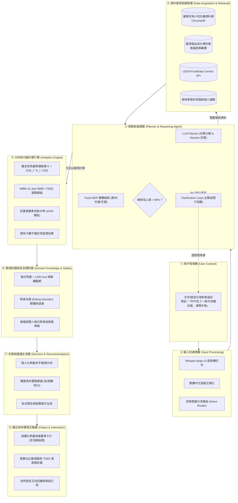

# DietSense 專案重構：Proposed Scheme 與設計工作流（Workflow）

> 本章節嚴格依據 2020 A-Z SOP 之 **PA～PM 結構** 與《期末專題提案作業規範》重構，呈現可落地的 Domain AI Agent 系統設計。

---

## PA. Aim 目標陳述
打造全臺首套兼顧繁體中文自然語言理解、在地飲食資料庫錨定、確定性代謝運算與臨床醫學安全邊界的領域智慧代理人（Domain AI Agent）——**DietSense**，實現從被動、繁瑣的手動熱量記錄，躍升為「主動、低認知負擔、情境感知與可解釋性」的個人化體重管理。

## PB. Based-on 理論與科學基礎
系統架構植基於三大科學基石：
1. **能量守恆與熱力學代謝定律**：遵循 Mifflin-St Jeor 公式與 TDEE 乘數模型，提供科學化的動態能量消耗參考基準。
2. **衛生福利部《國人膳食營養素參考攝取量》（DRIs）與每日飲食指南**：確立碳水化合物（50-65%）、蛋白質（10-20%）與脂肪（20-30%）之供能比例底線。
3. **Spec-Driven Agentic Architecture**：基於 OpenSpec 規範，實施「理解與計算解耦」、「白名單工具隔離」與「確定性微服務」原則。

## PC. Cure & Cause 解法及有用的根本原因
通用聊天機器人失敗的根本原因在於將「文字生成」與「數值計算」混為一談，導致隨機幻覺。DietSense 成功的核心在於：
> **「以 LLM 作為 Orchestrator（協調者），專司意圖分類、槽位抽取與對話引導；將資料檢索交由 Hybrid RAG，將算術計算交由 Python 確定性引擎，將醫學邊界交由硬性安全規則庫。」**

## PD. Design 架構典範轉移
實現兩大維度的典範轉移（Paradigm Shift）：
* **從 Form-Based GUI $\to$ Conversational CUI + Proactive Loops**：使用者不再逐層點選搜尋，而是透過語音／文字隨意描述，系統於關鍵資訊缺漏時發起主動追問（Clarification Loop）。
* **從 Point Estimate $\to$ Interval Estimate with Traceable Sources**：不再提供虛假精確的單一數值（例如 634 kcal），而是提供可信區間（例如 $600\sim 670\text{ kcal}$）、信心分數及引用的資料庫條目來源。

---

## PE. Paper Elements 八大系統架構模組（對應規範 ①～⑧）



* **① 用戶情境（User Scenario）**：支援真實日常用餐情境的口語輸入（文字或語音）。
* **② 輸入處理（Input Processing）**：Whisper 語音轉文字、臺灣飲食詞彙繁簡標準化，透過分類模型判定意圖（`log_food`, `query_nutrition`, `analyze_trends`, `recommend_diet`）。
* **③ 規劃與推理（Planner & Reasoning Agent）**：LLM 充當大腦，管理多輪對話 Context；若實體不完整或相似度過低，自動觸發 Clarification Loop。
* **④ 資料檢索（Data Acquisition & Retrieval）**：結合臺灣在地小吃向量庫、臺灣食品成分庫與 USDA API，提供精確營養素矩陣。
* **⑤ 分析引擎（Analytics Engine）**：由純 Python 數學函式構成，執行食材重量熱量積分計算、Mifflin-St Jeor TDEE 運算與不確定性區間估算。
* **⑥ 領域知識整合（Domain Knowledge Integration）**：整合臺灣每日飲食指南、AMDR 比例，並配置硬性安全檢查規則（低熱量限制與偏激節食防護）。
* **⑦ 決策建議（Decision & Recommendation）**：計算當日累積赤字、蛋白質攝取缺口，並提供具體可行的外食健康替代選項。
* **⑧ 輸出互動（Output & Interaction）**：產出結構化卡片、信賴區間、資料來源標籤以及個人化對話式總結。

---

## PF. Formulation & Foundation 核心數學模型

### 1. 飲食總熱量確定性計算模型
設一餐包含 $N$ 種食物成分，第 $i$ 種食物之估計重量為 $W_i$（公克），檢索所得該食物每 100 公克之熱量為 $K_i$（$\text{kcal/100g}$），則總攝入熱量 $E_{\text{total}}$ 為：
$$E_{\text{total}} = \sum_{i=1}^{N} \left( \frac{W_i}{100} \times K_i \right)$$

巨量營養素校驗公式（驗證計算無矛盾）：
$$E_{\text{macro}} = 4 \times \text{Carb(g)} + 4 \times \text{Protein(g)} + 9 \times \text{Fat(g)}$$
系統約束：$|E_{\text{total}} - E_{\text{macro}}| < \epsilon$（$\epsilon \le 2\text{ kcal}$，允許捨入誤差）。

### 2. Mifflin-St Jeor 代謝公式與 TDEE
基礎代謝率（BMR）：
$$\text{BMR} = 10 \times \text{Weight(kg)} + 6.25 \times \text{Height(cm)} - 5 \times \text{Age(years)} + s$$
其中性別偏移常數：男性 $s = +5$；女性 $s = -161$。

每日總能量消耗（TDEE）：
$$\text{TDEE} = \text{BMR} \times \text{Activity\_Factor}$$
（久坐型 1.2，輕度活動 1.375，中度活動 1.55，重度活動 1.725）。

---

## PG. Graph 架構說明
（參見上述 PE 之 Mermaid 完整架構拓撲圖）

---

## PH. How 系統工程落實方式
系統採用現代分散式微服務架構，後端由 FastAPI 驅動，LLM 核心介接 OpenAI / Google Gemini API，在地食物向量庫採用 ChromaDB，向量模型採用 `text-embedding-3-small`，資料庫查詢透過 SQLAlchemy 介接官方食品成分資料庫。

---

## PI. Implementation 核心演算法偽代碼（Algorithm 1）

```python
01: Algorithm 1: DietSense_Core_Orchestrator
02: Input : user_input Q (text/audio), user_profile P, daily_log D
03: Output: response R (analysis, visual_card, recommendation, log_update)
04: ---------------------------------------------------------------------------------
05: 01: text ← Preprocess_And_Normalize(Q)                  // Whisper ASR + 繁簡校正
06: 02: intent ← Classify_Intent(text)                      // log / query / analyze / recommend
07: 03: IF intent == "log_food" THEN
08: 04:     food_entities ← Extract_Food_Entities(text)    // NER: 食物名稱、數量量詞、烹調法
09: 05:     verified_items ← []
10: 06:     FOR EACH entity IN food_entities DO
11: 07:         candidates, sim_score ← Retrieve_Hybrid_RAG(entity.name) // 查在地向量庫與官方庫
12: 08:         // 信心評估：若相似度或份量模糊度未達門檻，發起澄清追問
13: 09:         WHILE sim_score < 0.80 OR entity.portion_is_ambiguous DO
14: 10:             clarification_question ← Generate_Clarification_Prompt(entity, candidates)
15: 11:             user_reply ← Ask_User(clarification_question)
16: 12:             entity ← Update_Entity_With_Context(entity, user_reply)
17: 13:             candidates, sim_score ← Retrieve_Hybrid_RAG(entity.name)
18: 14:         END WHILE
19: 15:         portion_interval ← Quantize_Portion_Weight(entity.portion, entity.context)
20: 16:         kcal_interval, macros ← Compute_Deterministic_Nutrition(candidates[0], portion_interval)
21: 17:         verified_items.append({item: candidates[0], weight: portion_interval, kcal: kcal_interval, macros: macros})
22: 18:     END FOR
23: 19:     D.append(verified_items)                        // 更新當日紀錄
24: 20: END IF
25: 21: 
26: 22: // 計算當日能量平衡與個人化分析
27: 23: daily_totals, total_interval ← Aggregate_Daily_Nutrients(D)
28: 24: bmr ← Compute_Mifflin_St_Jeor(P.weight, P.height, P.age, P.gender)
29: 25: tdee ← bmr * P.activity_factor
30: 26: energy_balance ← daily_totals.kcal - tdee
31: 27: 
32: 28: // 安全守門與醫學邊界檢查 (Safety Guardrail)
33: 29: safety_status ← Evaluate_Clinical_Safety(daily_totals, P, text)
34: 30: IF safety_status.violation_detected THEN
35: 31:     recommendation ← Trigger_Safety_Intervention(safety_status.type) // 拒絕偏激節食，提示健康專線
36: 32: ELSE
37: 33:     recommendation ← Synthesize_Personalized_Guidance(daily_totals, tdee, P.goal)
38: 34: END IF
39: 35: 
40: 36: R ← Render_Multimodal_Card(verified_items, total_interval, energy_balance, recommendation)
41: 37: RETURN R, D
```

---

## PJ. Jump to an Example 端到端實例演繹

* **使用者真實輸入**：「我剛吃了一碗加蛋牛肉麵，湯喝了一半。」
* **Step 1 (前處理與意圖)**：辨識為 `log_food`，抽取實體：
  * 食物 A：牛肉麵（份量：一碗，備註：湯喝半碗）
  * 食物 B：蛋（數量：一顆，烹調方式：未指定）
* **Step 2 (RAG 檢索與追問)**：
  * 檢索命中臺灣在地向量庫之「紅燒牛肉麵（含高湯）」與「清燉牛肉麵」。
  * 發現份量模糊（大碗/小碗？）與蛋的類型（滷蛋/水煮蛋/荷包蛋？），信心度 72%（$< 80\%$）。
  * **Agent 主動追問**：「收到！請問這碗牛肉麵是小碗還是大碗？裡面的蛋是滷蛋還是水煮荷包蛋呢？」
* **Step 3 (使用者補充)**：「是小碗的，加一顆滷蛋。」
* **Step 4 (確定性計算)**：
  * 小碗麵條約 160g、牛肉塊 4 塊（約 60g）、半碗紅燒牛肉高湯（約 250ml）。
  * 查庫計算：麵體 $240\text{ kcal}$、牛肉 $150\text{ kcal}$、高湯吸收與油脂 $180\text{ kcal}$、滷蛋一顆 $75\text{ kcal}$。
  * 傳遞不確定性：總熱量為 **$645 \pm 50\text{ kcal}$**（$595\sim 695\text{ kcal}$）。
  * 巨量營養素：蛋白質 36g、碳水化合物 68g、脂肪 24g。
* **Step 5 (安全檢查與反饋)**：無違規，對比使用者 TDEE（1,800 kcal），輸出精美卡片與健康建議：「這餐蛋白質非常充足！若想平衡鈉含量，建議下午多補充 500ml 溫水。」

---

## PK. Key Points Contribution 重點貢獻
1. 建立將 LLM 嚴格作為對話狀態機、白名單 Function Calling 隔離計算的開源標準實作。
2. 首創臺灣外食在地化 Clarification 追問樣式庫，解決外食雜訊大難以標準化的困境。
3. 採用動態不確定區間，向使用者誠實揭露 AI 預測邊界，建立醫療人機信任感。

## PL. Later Simulation 後續實驗驗證規劃
（詳見第 4 節 Experiments 規劃）

## PM. Math Proof 不確定性傳遞之數學模型
設總熱量 $E = \sum_i W_i K_i$，若每項食物份量 $W_i$ 具有標準差 $\sigma_{W_i}$，每百克熱量檢索具有標準差 $\sigma_{K_i}$，在各項相互獨立假設下，總熱量之一階誤差傳遞方差為：
$$\sigma_E^2 \approx \sum_{i=1}^{N} \left[ \left(\frac{K_i}{100}\right)^2 \sigma_{W_i}^2 + \left(\frac{W_i}{100}\right)^2 \sigma_{K_i}^2 \right]$$
DietSense 據此輸出 95% 信賴區間 $[E - 1.96\sigma_E, E + 1.96\sigma_E]$，奠定嚴謹的工程科學性。

