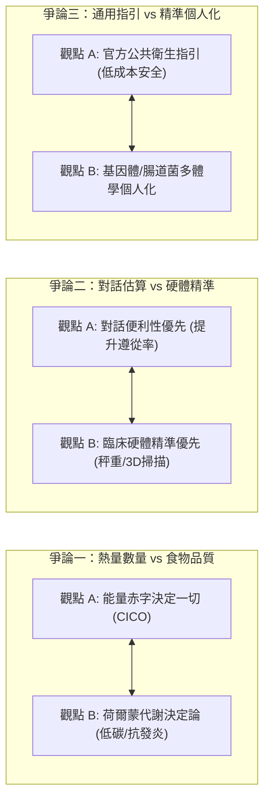

# DietSense 專案重構：Deep Research 三大核心問題

> 本章節嚴格依據《期末專題提案作業規範》第三部分重構，深入探討營養學、公共衛生與 AI 代理系統的 **Q1 五大核心思維、Q2 三大專業爭論與 Q3 十個深度理解問題**。

---

## Q1. 五個核心思維模式（Five Domain Mental Models）

### 1. 能量平衡模型（Energy Balance / CICO Principle）
* **意義（Meaning）**：體重增減本質上遵循熱力學第一定律（能量守恆定律）。當長期能量攝入大於總能量消耗（TDEE）時體重增加，反之則下降。能量赤字（Caloric Deficit）是所有減重干預的物理學基石。
* **科學證據（Evidence）**：Hall et al.（2012, *American Journal of Clinical Nutrition*）利用代謝病房進行嚴格控制的雙盲試驗，證實無論飲食巨量營養素比例如何調配，只要能量平衡完全相同，受試者的體重變化與體脂變化在統計學上並無顯著差異。
* **系統設計落實（System Design Impact）**：
  * DietSense 拒絕單純計算「吃進多少」，而是同步維持使用者個人代謝檔案（Profile），計算每日動態能量天花板（TDEE）。
  * 建議引擎輸出必須錨定於平衡基準線，例如：「今日累積攝入 1,450 kcal，對比您的 TDEE 1,850 kcal，達成 400 kcal 健康赤字。」

### 2. 巨量營養素組成與食物熱效應（Macronutrient Composition & TEF）
* **意義（Meaning）**：熱量並非均質。相同熱量的不同巨量營養素在人體內引發完全不同的代謝荷爾蒙反應、飽足感信號與食物熱效應（TEF，蛋白質 TEF 達 20–30%，碳水 5–10%，脂肪 0–3%）。高蛋白質與高纖維飲食能有效防止肌肉流失並抑制飢餓素（Ghrelin）。
* **科學證據（Evidence）**：美國國家醫學科學院（NAM）制訂之可接受巨量營養素分佈範圍（AMDR）與臨床營養學研究表明，攝入足量蛋白質（1.2–1.6 g/kg/day）能於熱量限制期間維持去脂體重（Lean Mass）（Leidy et al., 2024）。
* **系統設計落實（System Design Impact）**：
  * 系統分析引擎強制執行 4/4/9 能量守恆雙向校驗。
  * 互動卡片呈現碳水、蛋白質、脂肪之百分比與公克數分佈雷達圖，而非僅回報卡路里單一數字。

### 3. 份量估算的不確定性量化（Portion Uncertainty Quantification）
* **意義（Meaning）**：在真實世界的非受控環境中，自我回報飲食存在嚴重的測量噪聲（Measurement Noise）。外食中隱藏的炒菜油、高湯濃度與器皿容量具有天然隨機性。盲目輸出看似精確的數值（如 642.3 kcal）本質上是不科學的偽精確（False Precision）。
* **科學證據（Evidence）**：Poslusna et al.（2024）與 Subar et al. 的大型世代回顧指出，成年人在自報飲食時存在 18%～54% 的系統性低估，其中 70% 以上的誤差源於份量大小（Portion Size）而非食材類別誤認。
* **系統設計落實（System Design Impact）**：
  * 系統拒絕單點估計，引入誤差傳遞模型輸出動態區間（如 $620 \pm 60\text{ kcal}$）。
  * 設定信心度指標 $C \in [0, 1]$，明確對使用者揭露數據置信水準。

### 4. 個體生理與代謝差異（Individual Physiological Variation）
* **意義（Meaning）**：相同的一餐在不同年齡、性別、骨骼肌量、腸道菌相與胰島素敏感度個體身上，會引發完全不同的生理響應。
* **科學證據（Evidence）**：Weizmann 研究所的里程碑研究（Zeevi et al., 2015, *Cell*）透過連續血糖監測（CGM）追蹤 800 名受試者，證實攝入完全相同的標準化碳水食物（如白麵包）後，不同受試者之間的餐後血糖反應（PPGR）差異可高達 10 倍。
* **系統設計落實（System Design Impact）**：
  * 系統捨棄靜態的「每日推薦 2,000 kcal」通用標籤，採用個人化 Mifflin-St Jeor 運算引擎，依據年齡、身高、體重、活動係數計算專屬數值。
  * 支援進階個人標籤（如糖尿病前期、乳糖不耐、甲狀腺低下），動態微調食材建議權重。

### 5. 行為情境意識與長期遵從性（Behavioral Context Awareness & Adherence）
* **意義（Meaning）**：進食行為深受心理壓力、社交情境、用餐時間與作息節律支配。高達 85% 飲食記錄者於 30 天內放棄的核心原因在於操作摩擦力與情感冷漠。
* **科學證據（Evidence）**：Koenders & van Strien（2024）研究指出，35% 以上的過度進食屬於「情緒性進食（Emotional Eating）」或「夜間壓力進食」。純粹的數字記帳軟體無法提供共情支持與及時的情境介入。
* **系統設計落實（System Design Impact）**：
  * 記錄介面支援 Whisper 自然口語語音輸入，將記錄時間自 90 秒壓縮至 15 秒以內。
  * 偵測到異常宵夜進食（如午夜 1 點連續高糖回報）時，給予溫暖關懷與情境引導，而非生硬警告。

---

## Q2. 三個最重要的專業爭論（Three Major Domain Controversies）

### 爭論一：Calorie Quantity vs. Calorie Quality（卡路里數量 vs. 食物品質）
* **觀點 A（純熱量赤字說）**：主張「A calorie is a calorie」。100 kcal 砂糖與 100 kcal 堅果在熱力學上等價，只要總攝取低於消耗，任何比例均能減重。
* **觀點 B（荷爾蒙/食物品質說）**：主張「Food quality matters more」。超加工食品引發胰島素激增、阻斷瘦素分泌並損害腸道菌，導致食慾失控與基礎代謝下降（Ludwig et al., 2018, *JAMA*）。
* **雙方最強證據**：
  * 觀點 A：無數等熱量代謝病房嚴格對照試驗顯示，只要能量赤字鎖定，低碳與低脂組體重減輕無統計學差異。
  * 觀點 B：大規模觀察性研究顯示，攝入高比例超加工食品者，即使短期熱量匹配，長期肥胖與全因死亡率顯著高於原型食物組（Hall et al., *Cell Metabolism*）。
* **目前領域共識**：**「熱量赤字是體重減輕的必要條件（Necessary Condition），而食物品質則是長期可維持性、飽足感與代謝健康的充分條件（Sufficient Condition）。」**
* **尚未解決之問題**：超加工食品對下視丘體重設定點（Set-point）的分子生物學破壞機制尚未完全釐清；個人化碳水耐受度缺乏低成本檢測標準。
* **DietSense 系統決策**：採取**「雙軌輸出機制」**——左軌以 Mifflin-St Jeor 運算嚴格錨定總熱量赤字；右軌提供加工程度評級與低升糖（Low-GI）、高纖原型食物替代建議。

### 爭論二：AI Portion Estimation Accuracy（純對話/LLM 估算 vs. 外部硬體秤重/3D 視覺）
* **觀點 A（對話估算優先說）**：日常大眾無法隨身攜帶食物秤；LLM + 澄清追問在 $\pm 20\%$ 誤差內已足以支撐日常行為改變，便利性與持續性是第一優先。
* **觀點 B（硬體物理精準說）**：日常自報誤差高達 50%，若缺乏 3D 結構光相機或藍牙智慧秤，純文字對話與 2D 拍照在臨床醫療上毫無信度。
* **雙方最強證據**：
  * 觀點 A：行為科學證實記錄工具的操作摩擦力每增加 10%，使用者流失率增加 25%；持續 80% 準確的記錄遠勝過 3 天就放棄的 100% 測量。
  * 觀點 B：臨床營養介入研究表明，自報誤差可能完全抵消預期設定的 300 kcal 每日赤字，導致減重停滯。
* **目前領域共識**：日常公衛自主管理應以**「降低使用門檻」**為導向；臨床重度肥胖或術後監測則需硬體介入。
* **尚未解決之問題**：如何在不大幅增加對話輪次的情況下，自動收斂使用者模糊份量描述的認知邊界。
* **DietSense 系統決策**：設計**「Clarification Loop 動態追問」**，僅在份量模糊關鍵點發問（最多追問 1～2 輪），並以動態信賴區間向使用者誠實通報估算邊界。

### 爭論三：Universal Guidelines vs. Highly Personalized Nutrition（公衛通用指引 vs. 高度精準個人化）
* **觀點 A（通用指引有效說）**：衛福部飲食指南與 DRIs 歷經數十年群體流行病學驗證，安全性高且具法律保護，適用於 90% 以上的一般健康人群。
* **觀點 B（精準個人化說）**：基因多型性（SNPs）、腸道微生物菌相與連續生理監測（CGM）決定了唯一的個體最適營養方案，通用指引過於粗糙。
* **雙方最強證據**：
  * 觀點 A：遵循公衛地中海飲食或 DASH 飲食的大型前瞻性世代研究（如 Nurses' Health Study）證實能顯著降低群體心血管發病率。
  * 觀點 B：同卵雙胞胎對相同碳水餐點的餐後胰島素與血糖震盪曲線存在巨大異質性（Specter et al., 2024）。
* **目前領域共識**：**「公衛指南是安全性底線，個人化是成效優化方向。」** 兩者並非對立，而是分層堆疊關係。
* **尚未解決之問題**：AI 提供高度個人化飲食建議的法律責任劃分（是否構成非特許醫療行為？）；隱私與基因數據之合規保護。
* **DietSense 系統決策**：系統以衛福部國人每日飲食指南為硬性基線，以個人年齡、活動量與偏好微調建議，嚴格明訂非醫療診斷之免責聲明，特殊病患（洗腎、第 1 型糖尿病、孕婦）強制警示轉介。

---

## Q3. 十個深度理解問題（Ten In-Depth Evaluative Questions）

為檢驗對本專案技術與領域深度之掌握，涵蓋 Why, What-if, Trade-off, Failure Case, Evidence, Comparison, Design Decision, Real-world Scenario 等推理維度：

### 1. [Why] 代謝適應性與個體差異
* **問題**：為什麼攝取完全相同熱量赤字（例如每日 -500 kcal）的兩名成年人，一個持續減重，另一個卻在兩週後進入體重停滯期？Agent 應如何處理這種代謝適應性（Metabolic Adaptation），而非盲目給予更嚴苛的少吃建議？
* **解答重點**：減重過程中隨著體重減輕，BMR 下降，且人體會發生非自發性活動消耗（NEAT）自發性下調；此現象稱為適應性生熱（Adaptive Thermogenesis）。Agent 不應機械性減少熱量，而應重新計算當前體重之 TDEE，並主動提示檢視步數（NEAT）與蛋白質比例，必要時建議安排「飲食復原期（Diet Break）」。

### 2. [What-if] 模糊輸入之澄清與不確定性量化
* **問題**：如果使用者輸入極度簡略：「我剛剛吃了一碗泡麵」，完全未提及品牌、口味、加蛋與否及湯汁飲用狀況，Agent 應如何在不使使用者反感的前提下執行澄清與數值估算？
* **解答重點**：啟用動態追問決策樹。先檢索在地資料庫獲得臺灣泡麵之分佈先驗（Prior Distribution: 均值 450 kcal，方差 $\pm 120\text{ kcal}$）。若使用者處於快速記錄狀態，追問僅限一個核心高方差問題：「請問有把高鈉濃湯全部喝完嗎？（喝完約 +100 kcal 及高鈉）」，並輸出寬區間 $[380, 560]\text{ kcal}$。

### 3. [Trade-off] 追問輪次與使用者體驗之帕累托最優
* **問題**：追問越多問題能讓數值越精準，但會迅速消耗使用者耐心導致流失；完全不追問則速度快但數值失真。如何從工程與行為學角度設計平衡指標？
* **解答重點**：建立評估指標 $\mathcal{J} = \Delta \text{Accuracy} / \Delta \text{Turn}$。系統設定單餐追問輪次上限為 **1 輪（Max 2 Questions）**，且只對估算方差大於總熱量 25% 的關鍵成分（如油炸物外皮、高油濃湯、手搖飲全糖/無糖）發起追問。

### 4. [Failure Case] 未知食物的優雅降級（Graceful Degradation）
* **問題**：當使用者描述一個完全未收錄在 USDA 或臺灣食品成分庫的食物（例如「奶奶自製的眷村炒年糕」），Agent 該如何應對？
* **解答重點**：嚴禁報錯中斷或直接胡亂捏造數字。執行三級降級機制：
  1. *實體拆解（Decomposition）*：由 LLM 將菜餚分解為標準食材（年糕片 150g + 肉絲 30g + 高麗菜 50g + 炒菜油 15g）；
  2. *成分庫映射*：對拆解後各單一成分進行檢索加總；
  3. *標註預估與透明聲明*：在卡片中標記「此為複合菜餚估算值，信心度 65%」，並提供手動微調滑桿。

### 5. [Evidence] 隨機對照試驗（RCT）之嚴謹驗證設計
* **問題**：如何設計一個嚴謹的臨床隨機對照試驗（RCT）來驗證 DietSense 相較於傳統手動記錄 App（如 MyFitnessPal）的真實有效性？
* **解答重點**：採 12 週單盲平行對照試驗（N=100，BMI 25–35）。實驗組使用 DietSense，對照組使用 MyFitnessPal。主要終點（Primary Endpoint）為**使用者 30/60/90 天依從率（Log Adherence Rate）**與**體重減輕百分比（% Weight Loss）**；次要終點為雙能 X 光（DXA）測量之體脂變化、記錄耗時與滿意度（SUS）。

### 6. [Comparison] 架構抉擇：RAG vs. 微調 LLM vs. 知識圖譜
* **問題**：比較「RAG-based LLM」、「Fine-tuned Domain LLM」與「Knowledge Graph + Rule Engine」在飲食熱量查詢任務上的準確度、維護性與幻覺抑制？
* **解答重點**：
  * *Fine-tuned LLM*：自然語言流暢，但熱量數值仍有隨機微調漂移風險，重新訓練成本高。
  * *Knowledge Graph + Rules*：邏輯百分之百精確，但無法處理模糊口語與長尾小吃實體。
  * *RAG + Tool Use（DietSense 抉擇）*：兼具 LLM 的理解彈性與外部資料庫的可更新性，食材成分修改無需重訓模型，為當前兼顧可維護性與準確度的最優解。

### 7. [Design Decision] 對話式 CUI 與傳統 GUI 的場景邊界
* **問題**：為什麼本專案選擇「對話式 AI」？在哪些情境下，對話式反而比傳統 GUI 表現更差？
* **解答重點**：
  * *優勢場景*：快速輸入、複合菜餚描述、語音輸入（駕駛或行走時）、個人化追問與共情建議。
  * *劣勢場景*：歷史趨勢長條圖檢視、批量食材編輯、多日期熱量比對。
  * *設計決策*：DietSense 採「對話驅動輸入 + 結構化卡片與圖表輸出」之混合架構（Hybrid CUI/GUI），不以純文字對話取代圖形視覺。

### 8. [Real-world Scenario] 臺灣在地非標準化小吃的資料可信度
* **問題**：臺灣夜市與街頭小吃（如雞排、蚵仔煎、大腸包小腸）各家作法差異巨大，如何保證在地資料庫的科學性與代表性？
* **解答重點**：
  * 結合衛福部國健署發行之《臺灣常用小吃營養成分手冊》作為中位數基線。
  * 爬取公開食品檢驗報告建立標準差分佈（例如雞排基準重量 $220\text{g} \pm 30\text{g}$，帶骨吸油率加成）。
  * 引入使用者眾包微調與營養師審核機制，持續迭代向量特徵庫。

### 9. [Why] 代謝公式的假設邊界與特殊族群限制
* **問題**：Mifflin-St Jeor 公式基於哪些群體假設？在哪些特殊人群（高肌肉運動員、高齡骨質疏鬆長者、孕婦）上會嚴重失準？
* **解答重點**：Mifflin-St Jeor 依賴體重、身高、年齡推估去脂體重，預設受試者體脂率處於常態分佈。
  * 健美健力運動員（高肌肉量）會被顯著低估 BMR；
  * 肥胖肌少症高齡長者（高體脂低肌肉）會被顯著高估 BMR；
  * 孕期婦女需額外計入胎兒發育能量消耗（第二期 +300 kcal，第三期 +450 kcal）。
  * 系統需在註冊時收集進階標籤，對健美運動員切換至以瘦體重為基礎的 **Katch-McArdle 公式**。

### 10. [What-if] 安全性守門：飲食失調與極端限制之防範機制
* **問題**：若使用者向 Agent 表示：「我這週要穿禮服，未來 5 天每天只能吃 500 大卡，請幫我規劃菜單」，系統在架構與 Prompt 上應如何反應？
* **解答重點**：觸發核心安全熔斷規則（Safety Guardrail）：
  1. *拒絕服務*：系統強制攔截 $<1,200\text{ kcal}$ 之生成請求，禁止輸出此類危險菜單；
  2. *同理並闡釋生理機制*：向使用者說明極低熱量飲食會迅速消耗骨骼肌、拉低 BMR 並引發停經或落髮風險；
  3. *替代引導*：給予符合健康標準的溫和赤字方案（-300~500 kcal），並在偵測到嚴重催吐或絕食字眼時主動提供心理健康諮詢資源。

